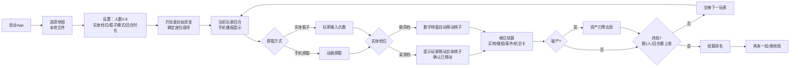

# MineMonopoly 离线桌游模式改造 PRD

| 项目 | 内容 |
|---|---|
| 项目名 | MineMonopoly（@mine-monopoly/root） |
| 文档版本 | v1.1 |
| 生效日期 | 2026-10-14 |
| 改造目标 | 从「多人在线联机」改造为「单机离线 · 一机主控 · 双档实体模式」 |
| 当前状态 | 方案评审稿（改造范围已冻结） |
| 主要读者 | 前端/Electron/Capacitor 开发、游戏策划、测试 |

---

## 1. 设计首页

### 项目一句话

一台手机当裁判与银行，最多 8 名玩家围着它轮流操作，经营资产，破产出局，最后一位幸存者获胜。实体道具按档位可选：极简档只有钞票，桌游档再加一张实体棋盘。

### 游玩条件

| 项 | 值 |
|---|---|
| 玩家数 | 2–8 人（默认推荐 4–6 人） |
| 平台 | 单台 Android 手机（Capacitor 打包）；iOS 后续适配 |
| 输入 | 触摸 + 可选实体骰子/钞票双轨 |
| 单局时长 | 45–90 分钟（8 人单轮 ≤ 10 分钟，默认每回合 60 秒） |
| 联网 | 无。飞行模式全程可玩 |
| 实体道具档位 | 极简档（仅钞票）/ 桌游档（钞票 + 实体棋盘），开局设置选择 |

### 玩家承诺

每个回合玩家只做一次关键判断：**这笔钱现在花，还是留着应付下一轮的风险**。买地、升级、参与交易都会改变局面，但都绑定同一个钱包。

### 设计支柱

1. **手机角色随档位切换。** 极简档下手机渲染数字棋盘并当裁判；桌游档下实体棋盘承担公共状态，手机只当裁判。两种档位共用同一套规则与记账，玩家按场景自选。反例：强制所有人都打印棋盘，或强制所有人看小屏，都会赶走一半场景的用户。
2. **资产以手机为权威，实体只是手感。** 手机是唯一记账端；实体钞票双轨下钞票只是演示物，不一致时以手机为准。反例：让实体钞票当权威，账会算错、会被私吞。
3. **回合边界必须硬锁定。** 非当前回合玩家无法操作手机，避免误触和偷看他人资产。反例：手机自由触控，8 人围坐必然误触。
4. **实体一致性由人执行，手机只提示。** 桌游档下移动棋子、交钞票、抽卡由玩家亲手做，手机提示后等玩家确认；极简档下只有钞票交付需要人工，棋子与抽卡在手机上自动完成。反例：手机自动走格，实体棋子跟不上，两套状态脱节。

### 核心动词

掷骰 → 移动 → 决策（买/升级/交易/弃）→ 结算 → 交棒

### 循环一句话

手机把骰子交给当前玩家 → 玩家移动（实体棋盘或数字棋盘）→ 手机按格位结算并更新资产 → 回合结束交给下一位 → 破产者出局，最后幸存者获胜。

### 范围与非目标

**本改造要做：**
- 主流程离线单机化（去掉在线依赖）
- 手机主控器（回合驱动、掷骰、记账、播报）
- 数字棋盘渲染（极简档）
- 实体棋盘/钞票配套与打印导出（桌游档）
- Capacitor Android 打包

**明确不做：**
- 不新增玩家自有设备接入（无第二手机/平板）
- 不保留玩家间实时同步（WebRTC/房间）
- 不做跨局存档与赛季系统
- 不做在线联机大厅

### 关键结论（已裁决）

| # | 决定 |
|---|---|
| 1 | 游戏逻辑在手机本地运行，复用现有 GameProcessWorker 架构 |
| 2 | 手机为资产权威记账端；实体钞票为可选双轨 |
| 3 | 默认手机内掷骰；实体骰子为可选模式 |
| 4 | 每回合默认 60 秒，8 人单轮 ≤ 10 分钟 |
| 5 | 实体道具两档：极简（仅钞票）/ 桌游（钞票+棋盘），开局设置选择 |
| 6 | 桌游档棋盘由地图编辑器导出打印（默认 300dpi） |

---

## 2. 现状诊断

### 2.1 现有架构与本改造的差距

| 现有能力 | 现状 | 改造动作 |
|---|---|---|
| 游戏逻辑（GameProcessWorker） | 在主机客户端 Web Worker 中单机运行 | **保留复用**，去掉同步外发 |
| 联机层（PeerJS/房间/Socket） | 依赖服务器认证与玩家间直连 | 主流程剔除，代码保留不进主流程 |
| Vue3 界面 | 面向单人操作、桌面/网页布局 | 改为主控器交互（回合锁定、大按钮、隐私遮罩） |
| 地图渲染（Three.js/PixiJS） | 客户端已有 3D/2D 渲染能力 | 复用于数字棋盘渲染（极简档） |
| 地图编辑器 | 编辑地图、角色、事件、卡牌 | 保留；新增"导出可打印棋盘"（桌游档） |
| Capacitor 管线 | 已有 build:capacitor / cap:android | 保留，作为主交付通道 |
| UI Schema | 声明式 UI 描述 | 保留，用于生成主控器操作面板 |

### 2.2 改造后数据流（离线）

**极简档（仅钞票）：**

```
┌─────────────────────────────────────────┐
│           手机（数字棋盘 + 裁判）          │
│  棋盘渲染 · 棋子位置 · 建筑状态 · 结算记账  │
│        GameProcessWorker（本地逻辑）      │
└─────────────────────────────────────────┘
              ▲ 玩家传手机轮流操作
              │ 只有钞票交付在桌面上进行
┌─────────────────────────────────────────┐
│            实体桌面（少量）               │
│            钞票/代币（可选）              │
└─────────────────────────────────────────┘
```

**桌游档（钞票 + 棋盘）：**

```
┌─────────────────────────────────────────┐
│              实体桌面（公共可见）          │
│  棋盘 · 钞票（棋子/卡牌由手机代管可选）    │
└─────────────────────────────────────────┘
              ▲ 玩家亲手移动/交付
              │ 手机语音提示"请移动棋子到X格"
┌─────────────────────────────────────────┐
│          手机主控器（唯一权威）            │
│  回合驱动 → 掷骰 → 格位结算 → 记账 → 播报  │
│        GameProcessWorker（本地逻辑）      │
└─────────────────────────────────────────┘
```

---

## 3. 玩法走读（60–120 秒连续游玩）

### 3.1 极简档走读（只有钞票）

4 人局，2 号玩家刚把手机从 1 号手里接过来。手机横屏显示着数字棋盘：一圈格位排成矩形，4 颗彩色棋子停在各自位置，建筑以小图标标在地块上。

手机亮着"2号玩家的回合"，顶部显示他的资产：12800 元。屏幕中央一颗大骰子，下方两个按钮："手机掷骰"和"实体骰子"。

2 号点"手机掷骰"。骰子动画滚出 5，手机播报："前进 5 格。"数字棋盘上他的棋子自动从"工坊"滑到"集市"——集市地块上立着 1 号玩家的两栋小屋图标。手机自动识别格位："集市，已被 1 号玩家拥有，需缴纳租金 800 元。"

2 号犹豫了一下。他手里现金只有 12800，还想留着钱在"码头"盖房子。他点了"确认缴纳"，把 800 元实体钞票交给 1 号玩家，同时在手机上点"已支付"；手机从 2 号资产中扣掉 800，加到 1 号名下，并播报："2 号玩家资产 12000 元。"

此时屏幕弹出"机会卡"提示。2 号点"抽卡"，手机翻开一张："跳蚤市场大甩卖：你的一块地皮市值 +500。"结算完成，回合结束，手机把控制权交给 3 号玩家，界面显示"请把手机交给 3 号玩家"。

### 3.2 桌游档走读差异（钞票 + 棋盘）

同样的局面下，手机只显示操作面板，不渲染棋盘。2 号掷出 5 后，手机播报"前进 5 格"，他拿起自己的实体棋子，在实体棋盘上从"工坊"走到"集市"——棋盘上已经竖着 1 号玩家的两栋小屋。抽机会卡时，他从桌面卡堆抽实体卡，念出内容后在手机点"我抽到了这张卡"，手机按卡号结算。

两个档位共享同一套规则、同一份记账、同一种回合交接；区别只在"棋盘/棋子/卡牌由谁呈现"。

---

## 4. 玩法架构

### 4.1 三层循环

| 层级 | 内容 |
|---|---|
| 瞬时（每回合） | 掷骰 → 移动 → 决策 → 结算 → 交棒，60 秒内完成 |
| 单局（45–90 分钟） | 资产增长 → 收购地皮 → 建楼收租 → 破产出局 → 最后幸存者胜 |
| 长期（跨局） | 不同地图（编辑器制作）→ 不同角色/事件卡组合 → 换地图即换玩法 |

### 4.2 Game Flow



---

## 5. 核心机制规格

### 5.1 回合主控规则（RULE-ROUND）

**目的**：8 人轮流操作单台手机，不误触、不混淆、不偷看。

| 项 | 规格 |
|---|---|
| 回合归属 | 手机按座位顺序锁定控制权，仅当前玩家可操作 |
| 交接 | 回合结束显示"请把手机交给 X 号玩家"，需点击"我收到了" |
| 回合计时 | 默认 60 秒/回合，可设 30–120 秒；超时仅提醒不强制 |
| 玩家数 | 2–8 人，开局设置 |
| 隐私 | 结算页仅在当前玩家确认后展示其资产；其余玩家资产在交接界面隐藏（遮罩） |

### 5.2 掷骰输入规则（RULE-DICE）

| 项 | 规格 |
|---|---|
| 默认模式 | 手机内掷骰（动画 + 结果），防作弊、零道具 |
| 可选模式 | 实体骰子，玩家输入 2–12 的点数，手机校验合法后结算 |
| 连续双数 | 沿用现有地图规则配置（如连续三次双数进监狱），由地图配置控制 |

### 5.3 资产记账规则（RULE-MONEY）

| 项 | 规格 |
|---|---|
| 权威端 | 手机（唯一权威） |
| 初始资金 | 默认 10000 游戏币/人，可配置 1000–100000 |
| 模式 A 纯手机 | 全部资产在手机内记账，实体零钞票 |
| 模式 B 双轨 | 实体钞票演示交易，玩家每笔支付后点"已支付"确认，手机同步记账 |
| 不一致处理 | 以手机为准，提示纠正后继续 |
| 破产 | 资产 < 0 且无可抵押 → 归零出局，地契退还银行/销毁（按地图规则） |

### 5.4 实体一致性规则（RULE-REALITY）

| 项 | 规格 |
|---|---|
| 移动棋子（桌游档） | 手机提示目标格位，玩家亲手移动后点"已移动" |
| 移动棋子（极简档） | 数字棋盘自动移动，无需人工 |
| 交付钞票 | 双轨模式下玩家当面交付，点"已支付"确认 |
| 抽取卡牌（桌游档） | 玩家抽实体卡，手机按卡号读取并结算 |
| 抽取卡牌（极简档） | 手机内抽卡，自动结算 |
| 手机故障/误操作 | 提供"撤销上一步"（仅当前回合内），回合结束锁定 |

### 5.5 实体档位规则（RULE-MODE）

| 项 | 规格 |
|---|---|
| 档位选择 | 开局设置中二选一，游戏中不可切换 |
| 极简档（仅钞票） | 手机渲染数字棋盘（地图/棋子/建筑）；实体仅钞票（可选） |
| 桌游档（钞票+棋盘） | 实体棋盘承担公共状态；手机只当裁判与记账 |
| 规则一致性 | 两档共享同一规则、同一记账、同一回合交接 |
| 默认值 | 默认桌游档（体验最佳），极简档适合零准备场景 |

### 5.6 终局与胜负

| 项 | 规格 |
|---|---|
| 终局条件 | 仅剩 1 名玩家；或达到地图配置的回合上限（默认 30 回合）后按资产排名 |
| 结算展示 | 排名、各玩家最终资产、局时统计 |
| 破产出局 | 资产归零后从座位循环移除，其地契按地图规则返还 |

---

## 6. 手机主控器功能规格

### 6.1 界面结构（主控器模式）

**极简档**：

```
┌──────────────────────────────┐
│ 顶部状态条：当前回合玩家/资产/计时 │
├──────────────────────────────┤
│     数字棋盘（地图+棋子+建筑）     │
│     缩放/平移/当前格位高亮        │
├──────────────────────────────┤
│ 操作区：[掷骰] [确认支付] [抽卡] │
│         [撤销]                │
├──────────────────────────────┤
│ 底部：回合交接/设置/结算入口      │
└──────────────────────────────┘
```

**桌游档**：

```
┌──────────────────────────────┐
│ 顶部状态条：当前回合玩家/资产/计时 │
├──────────────────────────────┤
│       中央操作区（大按钮）        │
│   [掷骰] [确认移动] [确认支付]   │
│   [抽卡] [撤销]               │
├──────────────────────────────┤
│ 底部：回合交接/设置/结算入口      │
└──────────────────────────────┘
```

### 6.2 页面清单

| 页面 | 功能 | 关键约束 |
|---|---|---|
| 开局设置 | 选地图（本地）、人数、实体档位、骰子模式、钞票模式 | 地图需为已下载的离线文件 |
| 回合主界面 | 掷骰、结算、记账、播报（+ 极简档数字棋盘） | 当前玩家锁定；隐私遮罩 |
| 结算页 | 排名、资产、统计 | 终局触发，可"再来一局" |
| 打印导出页（编辑器侧） | 棋盘导出（桌游档） | 见 §7 |

### 6.3 语音播报（可选增强）

- 回合提示："轮到 3 号玩家"
- 格位结算："前进 5 格，到达集市，缴纳租金 800 元"
- 交接："请把手机交给 4 号玩家"
- 档位提示（极简档）："请把手机横过来查看棋盘"
- 开关：开局设置中可关闭

### 6.4 数字棋盘渲染（极简档）

| 项 | 规格 |
|---|---|
| 渲染方式 | 复用客户端 Three.js/PixiJS 渲染能力，手机横屏全屏展示地图 |
| 状态呈现 | 玩家棋子位置、地块归属、建筑等级、当前格位高亮 |
| 交互 | 支持缩放、平移；点击格位查看地契详情（购买价/租金/升级费） |
| 性能 | 8 人局 + 全图建筑图标，60fps 流畅；低端机降级为静态 2D |
| 与桌游档关系 | 同一份地图数据、同一套规则，只切换"棋盘呈现层" |

---

## 7. 实体道具方案

### 7.1 道具清单与规格（按档位）

| 档位 | 道具 | 数量 | 规格/材质 | 来源 |
|---|---|---|---|---|
| 极简档 | 钞票/代币（可选） | 1 套 | 面值 100/500/1000/5000，各若干张 | 打印/采购 |
| 桌游档 | 实体棋盘 | 1 | A2/A3 覆膜印刷，地图编辑器导出（默认 300dpi） | 打印 |
| 桌游档 | 钞票/代币 | 1 套 | 面值 100/500/1000/5000，各若干张 | 打印/采购 |
| 桌游档可选 | 玩家棋子 | 8 | 木质/塑料小人，8 色区分（也可用手机代管位置） | 采购 |
| 桌游档可选 | 骰子 | 2 颗 | 标准六面骰（可加 1 颗事件骰） | 采购 |
| 桌游档可选 | 地契卡 | 按地图格数 | 含购买价/租金/升级费用（也可手机代管） | 打印 |
| 桌游档可选 | 事件/机会卡 | 1 副 | 卡面编号，与手机卡库对应（也可手机代管） | 打印 |
| 两档可选 | 建筑模型 | 若干 | 小屋/旅馆小木块（也可手机图标代管） | 采购 |

> 说明：即使选择桌游档，棋子/卡牌/建筑也都可以由手机代管，实体棋盘上只放棋子位置与钞票，准备成本仍很低。

### 7.2 打印导出能力（桌游档）

| 导出项 | 输出 | 用途 |
|---|---|---|
| 棋盘 | PNG（≥300dpi）/ SVG / PDF | 印刷店制作实体棋盘 |
| 地契卡（可选） | PNG/PDF 卡片（打印后裁剪） | 与地图格位一一对应 |
| 事件/机会卡（可选） | PNG/PDF 卡片（含编号） | 手机卡库同编号结算 |
| 初始资金说明页 | PNG/PDF | 双轨模式下玩家分配起始钞票 |

### 7.3 档位与钞票模式说明

- **极简档（仅钞票）**：手机渲染数字棋盘，实体只准备一叠钞票（甚至可以纯手机记账、零钞票），最适合"今天就想玩、零准备"的场景；
- **桌游档（钞票+棋盘）**：打印一张棋盘即可获得完整桌游感，棋子/卡牌/建筑可由手机代管，适合正式聚会。

---

## 8. 技术改造方案

### 8.1 目标架构

```
apps/client
├── core/            # 复用：GameProcessWorker 游戏逻辑（本地单机）
├── platform/        # 新增：tabletop 主控器模式入口
├── views/           # 新增：tabletop 开局/回合/结算页面
├── board/           # 新增：棋盘呈现层（数字棋盘 / 实体棋盘提示 双实现）
├── stores/          # 新增：tabletop 会话状态（玩家、资产、回合、档位）
├── services/        # 新增：打印导出服务（对接 map-editor 导出）
└── capacitor 打包    # Android APK 主交付
```

### 8.2 改动清单

| # | 改动 | 类型 | 说明 |
|---|---|---|---|
| 1 | 主流程去掉在线依赖 | modify | 启动不请求服务器；联机代码不进主流程 |
| 2 | 新增 TabletopMode 入口 | add | 应用启动直接进入主控器模式 |
| 3 | 回合驱动状态机 | add | 复用 SM-GAME（设置→回合→结算→终局） |
| 4 | 棋盘呈现层（双档） | add | 数字棋盘渲染（极简档）+ 实体棋盘提示（桌游档） |
| 5 | 打印导出管线 | add | 编辑器导出棋盘 PNG/PDF（桌游档） |
| 6 | Capacitor Android 打包 | modify | 确保离线资源内置（地图、卡库） |
| 7 | UI 主控器化 | modify | 大按钮、回合锁定、隐私遮罩、语音播报 |

### 8.3 技术风险

| 风险 | 影响 | 缓解 |
|---|---|---|
| 数字棋盘在低端机卡顿 | 极简档体验差 | 降级为静态 2D，60fps 预算校验 |
| 地图导出分辨率不足 | 桌游档棋盘模糊 | 300dpi 校验，提供 SVG/PDF 矢量导出 |
| 8 人轮流操作误触 | 错账、泄露 | 回合硬锁定 + 确认 + 隐私遮罩 |
| Capacitor 离线资源加载 | 启动失败 | 地图/卡库内置 asset，飞行模式验证 |
| 语音播报适配 | 播报不全 | 系统 TTS，可关闭 |

---

## 9. 首个可玩范围（P0）

### 9.1 P0 内容

| # | 项 | 验收标准 |
|---|---|---|
| 1 | 离线单机主流程 | 飞行模式下启动→开局→完整一局可玩 |
| 2 | 回合驱动与 8 人支持 | 8 人完整回合循环，座位顺序正确 |
| 3 | 手机掷骰 + 实体骰子模式 | 两种模式均正确结算 |
| 4 | 资产记账（含破产） | 记账一致，破产出局正确 |
| 5 | 实体档位双档支持 | 极简档/桌游档各自完整走通一局，规则与记账一致 |
| 6 | 数字棋盘渲染（极简档） | 棋子位置/建筑状态正确，横屏可缩放 |
| 7 | 棋盘打印导出（桌游档） | 300dpi PNG 可打印 |
| 8 | Android APK 打包 | 安装运行正常 |

### 9.2 P1 / 非目标

- **P1**：语音播报、实体钞票双轨、抵押系统、实体卡牌打印、玩家记录板打印
- **非目标**：iOS、跨局存档、在线功能、玩家自有设备接入

### 9.3 容量与人力（P0 预算 18 人日）

| 任务 | 人日 | 优先级 |
|---|---|---|
| 离线单机模式改造与主控器架构 | 4 | P0 |
| 回合驱动 UI 与多玩家接管交互 | 3 | P0 |
| 数字棋盘渲染（极简档） | 3 | P0 |
| 棋盘导出打印（桌游档） | 2 | P0 |
| Capacitor 安卓打包与接线验证 | 2 | P0 |
| 道具配置与规则参数落地 | 2 | P0 |
| 8 人局回归与修复 | 2 | P0 |

### 9.4 验证清单

| 测试 | 场景 | 预期 |
|---|---|---|
| TEST-8P | 8 人开局完整回合循环 | 座位正确、无卡顿 |
| TEST-OFFLINE | 飞行模式完整游玩 | 全程无需网络 |
| TEST-BANKRUPT | 资产 <0 且无法抵押 | 归零出局、剩余玩家继续 |
| TEST-DICE-MANUAL | 实体骰子输入 | 按点数结算、拒绝越界值 |
| TEST-REALITY-MISMATCH | 实体与手机不一致 | 以手机为权威并提示纠正 |
| TEST-MODE-LITE | 极简档完整一局 | 数字棋盘状态正确、规则一致 |
| TEST-MODE-BOARD | 桌游档完整一局 | 实体棋盘提示正确、规则一致 |

---

## 10. 里程碑

| 阶段 | 内容 | 出口标准 |
|---|---|---|
| M1（3 天） | 离线化 + 主控器状态机 | 飞行模式可完整单机运行 |
| M2（4 天） | 回合 UI + 数字棋盘 + 8 人交互 | 双档 8 人实测回合流转无错 |
| M3（2 天） | 棋盘打印导出 + 道具制作 | 样张打印清晰 |
| M4（2 天） | Android 打包 + 回归 | APK 安装可玩，7 项测试通过 |

---

## 11. 设计契约摘要（校验已通过）

| 断言 | 结果 |
|---|---|
| 8 人 × 60 秒 = 480 秒 ≤ 600 秒（10 分钟单轮） | PASS |
| 300dpi ≥ 150dpi（打印清晰度下限） | PASS |
| 范围冻结（离线/单机主控/8人/实体道具） | PASS |
| 状态机可达性与恢复 | PASS |

---

*本文档为 MineMonopoly 离线桌游模式改造的当前真值。变更请更新本文档并同步 §5 规则、§8 架构与 §9 验收。*
